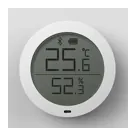

# Shelly HomeKit Garage BLU

Firmware dla **Shelly Plus 1** i **Shelly 1 Gen3**, który łączy bramę garażową z Apple HomeKit
bez dodatkowego mostka. Dwa bezprzewodowe kontaktrony **Shelly BLU, Xiaomi lub Qingping** potwierdzają
pełne zamknięcie i otwarcie. Sterownik komunikuje się z HomeKit przez Wi-Fi,
a z urządzeniami BLU przez Bluetooth. Projekt bazuje na
[Shelly-HomeKit](https://github.com/mongoose-os-apps/shelly-homekit).

**Publiczne OTA: Shelly Plus 1 — 2.16.1_blu.65; Shelly 1 Gen3 — 2.16.1_blu.59 (2026-10-27).**
Dla każdego modelu jest osobny ZIP i suma SHA-256. Panel WWW obsługuje **polski i angielski**;
wybór języka znajduje się w sekcji System. Dokumentacja użytkownika jest po polsku.

**Najnowsza aktualizacja Plus 1:** zapisywanie baterii Xiaomi Door & Window Sensor 2 na 24 godziny, także po restarcie, oraz rozwijane menu języka „English / Polski” z zapamiętywaniem wyboru.

[Instalacja i aktualizacje](docs/AKTUALIZACJA.md) ·
[Konfiguracja i obsługa](docs/KONFIGURACJA.md) ·
[Rozwiązywanie problemów](docs/ROZWIAZYWANIE_PROBLEMOW.md) ·
[Historia zmian](docs/HISTORIA_ZMIAN.md) ·
[Dokumentacja techniczna (EN)](README-BLU.md)

## Idea projektu

Dwie krańcówki BLE pozwalają potwierdzać oba końcowe położenia bez prowadzenia
przewodów do czujników. Zwolnienie jednego kontaktronu oznacza wyłącznie, że brama
opuściła dane położenie; drugi czujnik potwierdza osiągnięcie przeciwnego końca.
Stan może być odświeżany także wtedy, gdy bramę uruchomiono pilotem lub przyciskiem
napędu. Pozycja pomiędzy krańcówkami jest szacowana z czasu ruchu.

## Wspierany sprzęt

<table>
<thead><tr><th width="340">Akcesorium / sterownik i model</th><th width="110">Zdjęcie</th><th>Dane i funkcje</th></tr></thead>
<tbody>
<tr><th colspan="3" align="left">Sterowniki</th></tr>
<tr><td width="340"><strong>Shelly Plus 1</strong> <code>SNSW-001X16EU</code></td><td align="center"></td><td><ul><li>Sterowanie przekaźnikiem bramy</li><li>Odbiór Bluetooth</li><li>Panel WWW i Apple HomeKit</li></ul></td></tr>
<tr><td width="340"><strong>Shelly 1 Gen3</strong> <code>S3SW-001X16EU</code></td><td align="center"></td><td><ul><li>Sterowanie przekaźnikiem bramy</li><li>Odbiór Bluetooth</li><li>Panel WWW i Apple HomeKit</li></ul></td></tr>
<tr><th colspan="3" align="left">Czujniki otwarcia i zamknięcia</th></tr>
<tr><td width="340"><strong>Shelly BLU Door Window</strong> <code>SBDW-002C</code></td><td align="center"></td><td><ul><li>Stan otwarcia / zamknięcia</li><li>Poziom baterii (%)</li><li>Siła sygnału Bluetooth (RSSI)</li></ul></td></tr>
<tr><td width="340"><strong>Xiaomi Door &amp; Window Sensor 2</strong> <code>MCCGQ02HL</code></td><td align="center"></td><td><ul><li>Stan otwarcia / zamknięcia</li><li>Poziom baterii (%)</li><li>Siła sygnału Bluetooth (RSSI)</li></ul></td></tr>
<tr><td width="340"><strong>Qingping Door &amp; Window Contact Sensor</strong> <code>CGH1</code></td><td align="center"></td><td><ul><li>Stan otwarcia / zamknięcia</li><li>Poziom baterii (%)</li><li>Siła sygnału Bluetooth (RSSI)</li></ul></td></tr>
<tr><th colspan="3" align="left">Czujniki ruchu i jasności</th></tr>
<tr><td width="340"><strong>Shelly BLU Motion</strong> <code>SBMO-003Z</code></td><td align="center"></td><td><ul><li>Wykrycie ruchu</li><li>Natężenie oświetlenia (lx)</li><li>Poziom baterii (%)</li><li>Siła sygnału Bluetooth (RSSI)</li></ul></td></tr>
<tr><td width="340"><strong>Qingping Motion &amp; Ambient Light Sensor</strong> <code>CGPR1</code></td><td align="center"></td><td><ul><li>Wykrycie ruchu</li><li>Natężenie oświetlenia (lx)</li><li>Poziom baterii (%)</li><li>Siła sygnału Bluetooth (RSSI)</li></ul></td></tr>
<tr><td width="340"><strong>Xiaomi Motion Sensor 2S</strong> <code>XMPIR02SXS — Chiny</code> <code>XMPIR02SGXS — globalny</code></td><td align="center"></td><td><ul><li>Wykrycie ruchu</li><li>Natężenie oświetlenia (lx)</li><li>Poziom baterii (%)</li><li>Siła sygnału Bluetooth (RSSI)</li></ul></td></tr>
<tr><th colspan="3" align="left">Temperatura i wilgotność: wewnątrz i na zewnątrz</th></tr>
<tr><td width="340"><strong>Shelly BLU H&amp;T</strong> <code>SBHT-003C</code></td><td align="center"></td><td><ul><li>Temperatura (°C)</li><li>Wilgotność (%)</li><li>Poziom baterii (%)</li><li>Siła sygnału Bluetooth (RSSI)</li></ul></td></tr>
<tr><td width="340"><strong>Xiaomi Mi Temperature and Humidity Monitor</strong> <code>LYWSDCGQ/01ZM</code></td><td align="center"></td><td><ul><li>Temperatura (°C)</li><li>Wilgotność (%)</li><li>Poziom baterii (%)</li><li>Siła sygnału Bluetooth (RSSI)</li></ul></td></tr>
<tr><td width="340"><strong>Xiaomi Mi Temperature and Humidity Monitor 2</strong> <code>LYWSD03MMC</code></td><td align="center"></td><td><ul><li>Temperatura (°C)</li><li>Wilgotność (%)</li><li>Poziom baterii (%; z GATT szacowany z napięcia)</li><li>Siła sygnału Bluetooth (RSSI)</li></ul></td></tr>
<tr><td width="340"><strong>Qingping Temperature &amp; Humidity Monitor</strong> <code>CGG1</code></td><td align="center"></td><td><ul><li>Temperatura (°C)</li><li>Wilgotność (%)</li><li>Poziom baterii (%)</li><li>Siła sygnału Bluetooth (RSSI)</li></ul></td></tr>
<tr><th colspan="3" align="left">Przycisk i obecność auta</th></tr>
<tr><td width="340"><strong>Shelly BLU Button1</strong> <code>SBBT-002C</code></td><td align="center"></td><td><ul><li>Pojedyncze, podwójne i długie naciśnięcie</li><li>Obecność przycisku w zasięgu BLE</li><li>Sterowanie bramą pojedynczym naciśnięciem</li><li>Poziom baterii (%)</li><li>Siła sygnału Bluetooth (RSSI)</li></ul></td></tr>
</tbody>
</table>

Urządzenia parujesz w panelu WWW Garage BLU. Szyfrowane czujniki Xiaomi i Qingping wymagają **Bindkey BLE** — 32-znakowego klucza sprawdzanego podczas parowania. Shelly BLU oraz Xiaomi Mi Temperature and Humidity Monitor (LYWSDCGQ/01ZM) nie wymagają ręcznego podawania klucza.

Ostatnie odczyty temperatury i wilgotności są zachowywane przez **godzinę**. Xiaomi Mi Temperature and Humidity Monitor 2 (LYWSD03MMC) obsługuje też eksperymentalny odczyt bezpośredni; w tym trybie poziom baterii jest szacowany z napięcia.

Firmware Garage BLU instalujesz tylko na sterowniku — akcesoria zachowują swoje oprogramowanie. Wybierz paczkę dla **Shelly Plus 1** lub **Shelly 1 Gen3**. Paczki nie są zamienne i nie obsługują wersji Mini ani 1PM.

Instrukcja dla Gen3: [instalacja i konfiguracja Shelly 1 Gen3](docs/SHELLY_1_GEN3.md).

## Funkcje

| Funkcja | Zachowanie |
| --- | --- |
| Parowanie w panelu | Wyszukiwanie pobliskich urządzeń z nazwą modelu, miniaturą dla modeli z katalogu, MAC i RSSI. Jeden zgodny model jest wybierany automatycznie. Shelly BLU korzysta z konfiguracji automatycznej, szyfrowany Xiaomi/Qingping z Bindkey BLE. |
| Zarządzanie akcesoriami | Własne nazwy, separatory, przycisk Usuń zamiast Sparuj dla przypisanych urządzeń. Odebrany beacon na chwilę podświetla badge na niebiesko. |
| Temperatura | Dwa niezależne miejsca: wewnątrz i na zewnątrz. Ostatni pomiar zachowywany przez godzinę. |
| Szyfrowane odczyty | AES-CCM BTHome v2 i MiBeacon v4/v5, sprawdzanie MAC i klucza oraz ochrona przed ponownym użyciem pakietów. |
| Wiarygodny stan | Polecenia są blokowane przy brakujących, nieaktualnych lub sprzecznych odczytach krańcówek oraz podczas parowania. |
| Nazwy akcesoriów | Name pod Pair zapisuje nazwę urządzenia; Motion, Button1 i H&T używają jej na wizualizacji. Oddzielne Car name pod Button1 nazywa kafelek auta. Nazwa bramy pochodzi z Name w sekcji Garage Door. Krańcówki są opisane w ustawieniach. |
| Wizualizacja | Motywy Day / Night / Auto, animacja bramy, kafelki ruchu i Button1, odczyty temperatury i wilgotności. Przy włączonym haśle widok jest dostępny po zalogowaniu; podczas OTA jest ukryty. |
| Obecność auta | Nowy poprawnie odszyfrowany pakiet Button1 pokazuje auto, brak pakietów przez 45 s je ukrywa. Ręczny wybór zmienia równocześnie grafikę i kafelek Car presence do następnego pakietu lub zmiany obecności. |
| Oświetlenie | Light sensor w HomeKit korzysta z LUX sparowanego czujnika ruchu. Ma oddzielną kontrolę świeżości pomiaru i status dostępności. |
| Sterowanie Button1 | Pojedynczy nacisk: otwórz / zatrzymaj / zamknij zgodnie ze stanem bramy. W HomeKit: obecność auta i przycisk programowalny (pojedyncze / podwójne / długie naciśnięcie), we wspólnym akcesorium Shelly. Sam beacon nie uruchamia przekaźnika. |
| Kierunek po zatrzymaniu | Continue previous direction after stop: wyłączony — zmiana kierunku; włączony — kontynuacja poprzedniego. Opcję trzeba dopasować do reakcji napędu. |
| Obstruction | Przekroczenie czasu ruchu jest sygnalizowane w panelu i HomeKit. Animacja pokazuje umowne 50%; prawidłowo potwierdzona krańcówka usuwa błąd. |
| OTA | Firmware → Update → Check → Install lub Update from file → Upload. Kanał i paczki są na hejsiri.pl. |

Obecność oznacza zasięg BLE przycisku, a nie potwierdzenie miejsca zaparkowania.
Animacja nie mierzy odległości ani rzeczywistego procentu otwarcia bramy.
Blokowanie nowych impulsów nie zatrzymuje napędu już będącego w ruchu i nie zastępuje
jego zabezpieczeń.

## Szybki start

1. [Zainstaluj właściwy ZIP](docs/AKTUALIZACJA.md) na właściwym Shelly Plus 1 lub Shelly 1 Gen3.
2. W Security Settings ustaw hasło panelu. W General Settings wybierz Mode → Garage Door Opener i Save.
3. W sekcji bramy sparuj Closing sensor i Opening sensor przez Pair. Czujniki mają wykrywać swoje magnesy wyłącznie w odpowiednich skrajnych położeniach.
4. Włącz BLU sensors, ustaw czasy zgodnie z napędem i zapisz Save. Sprawdź wskazania obu krańcówek.
5. Opcjonalnie sparuj Motion, Indoor / Outdoor H&T i Button1; wpisz własne nazwy w Name i zapisz.
   Dla Xiaomi wybierz **Xiaomi LYWSDCGQ/01ZM** przy Indoor H&T albo Outdoor H&T, a potem **Pair**. Włącz czujnik i zostaw go blisko Shelly. Nie wymaga klucza, konta Xiaomi ani trybu parowania.
6. W HomeKit Settings wybierz Setup i dodaj akcesorium w aplikacji Dom za pomocą wyświetlonego kodu.

[Pełna konfiguracja krok po kroku](docs/KONFIGURACJA.md) opisuje pola,
statusy i zachowanie po zatrzymaniu. Przy problemach zacznij od
[diagnostyki](docs/ROZWIAZYWANIE_PROBLEMOW.md).

Repozytorium zawiera profile sprzętu tylko dla **Shelly Plus 1** i **Shelly 1 Gen3**.
Instrukcje budowania, testów i struktura kodu są w [README-BLU.md](README-BLU.md#build-and-test).

## Pobieranie i aktualizacja

- [Paczki i opis na hejsiri.pl](https://hejsiri.pl/firmware/garage-blu/)
- [ZIP 2.16.1_blu.65 dla Shelly Plus 1](https://hejsiri.pl/firmware/garage-blu/shelly-homekit-garage-blu-ShellyPlus1-2.16.1_blu.65.zip)
- [SHA-256 Plus1](https://hejsiri.pl/firmware/garage-blu/shelly-homekit-garage-blu-ShellyPlus1-2.16.1_blu.65.zip.sha256)
- [ZIP 2.16.1_blu.59 dla Shelly 1 Gen3](https://hejsiri.pl/firmware/garage-blu/shelly-homekit-garage-blu-Shelly1Gen3-2.16.1_blu.59.zip)
- [SHA-256 Gen3](https://hejsiri.pl/firmware/garage-blu/shelly-homekit-garage-blu-Shelly1Gen3-2.16.1_blu.59.zip.sha256)
- [Instrukcja instalacji, aktualizacji i kontroli po restarcie](docs/AKTUALIZACJA.md)

Kanały dla Plus 1 i Gen3 mogą udostępniać różne wersje. Paczki mają osobne profile sprzętu.
Publiczne metadane obu wydań mają `hardware_tested: false`; próby poszczególnych funkcji
na Plus 1 nie oznaczają pełnej weryfikacji całego wydania. Test fizycznego Gen3 pozostaje do wykonania.
Nie publikuj haseł, kodów HomeKit ani kluczy BLE w zgłoszeniach.

## Projekt, zgłoszenia i rozwój

- [Repozytorium Garage BLU](https://github.com/hejsiri/shelly-homekit-garage-blu)
- [Zgłoszenia błędów i propozycje](https://github.com/hejsiri/shelly-homekit-garage-blu/issues)
- [Budowanie, testy i publikowanie (EN)](README-BLU.md)
- [Historia zmian](docs/HISTORIA_ZMIAN.md)
- [Projekt bazowy Shelly-HomeKit](https://github.com/mongoose-os-apps/shelly-homekit)

W zgłoszeniu podaj wersję sterownika, model i firmware urządzenia BLU oraz dokładny
komunikat błędu. Nie publikuj haseł, PIN-ów, kodu HomeKit ani kluczy BTHome.

## Autorzy i licencja

Projekt korzysta z pracy autorów [Shelly-HomeKit](https://github.com/mongoose-os-apps/shelly-homekit)
wymienionych w [AUTHORS.md](AUTHORS.md). Licencja: [Apache 2.0](LICENSE).
